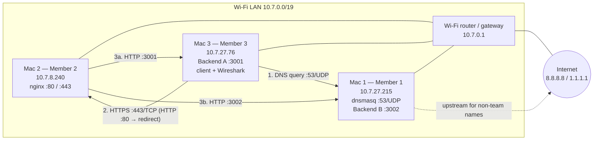

# Private Network Service Platform — Architecture

Owner: Member 1 (Mac 1). Domain: `team1.test`. Network: 10.7.0.0/19 on one Wi-Fi (SSID Rishihood_Learner), gateway 10.7.0.1. No cloud.

## 1. IP / service table

| Host | Member | IPv4 (en0) | MAC (private Wi-Fi) | Services |
| --- | --- | --- | --- | --- |
| Mac 1 | Member 1 | 10.7.27.215/19 | b6:68:5e:6e:58:51 | dnsmasq DNS **53/UDP+TCP**, Backend B **3002/TCP** |
| Mac 2 | Member 2 | 10.7.8.240/19 | TODO | nginx edge **80/443/TCP**, local CA, HTTPS, caching |
| Mac 3 | Member 3 | 10.7.27.76/19 | b6:d8:ae:24:f5:f1 | Backend A **3001/TCP**, test client, Wireshark |
| Router | — | 10.7.0.1 | — | Wi-Fi AP + default gateway |

DNS records (served by Mac 1, TTL 30 s):

| Name | Type | Value |
| --- | --- | --- |
| app.team1.test | A | 10.7.8.240 |
| api.team1.test | A | 10.7.8.240 |
| *anything else*.team1.test | — | NXDOMAIN (`local=/team1.test/`) |

## 2. Topology

## 3. Ping matrix (`ping -c 4`)

| From \ To | Mac 1 | Mac 2 | Mac 3 |
| --- | --- | --- | --- |
| Mac 1 | — | ✅ 4/4, 0 % loss (avg 9.1 ms) | ✅ 4/4, 0 % loss (avg 36.8 ms) |
| Mac 2 | TODO | — | TODO |
| Mac 3 | ✅ 4/4, 0 % loss (avg 8.3 ms) | ✅ 4/4, 0 % loss (avg 21.8 ms) | — |

Evidence: `evidence/phase1/A-lan/`.

## 4. Request flow by layer

A client opens `https://app.team1.test/api/status`:

1. **DNS (application layer, UDP 53).** The client's resolver asks Mac 1 (`10.7.27.215`) for `app.team1.test A`. dnsmasq answers from `host-record` with 10.7.8.240 (Mac 2) and TTL 30. The client caches the answer for 30 s. Proof: `dig @10.7.27.215 app.team1.test`, `/tmp/dnsmasq.log`, a Wireshark `dns` filter.
2. **TCP (transport, 443).** The client does a 3-way handshake (SYN, SYN-ACK, ACK) with Mac 2:443. Proof: `nc -vz 10.7.8.240 443`, Wireshark `tcp.flags.syn==1`.
3. **TLS.** TODO (Member 2): TLS version, cipher, certificate chain (leaf `app.team1.test` signed by the team CA), SAN list, and how clients trust `team-ca.crt`. Proof: `curl -v` shows "SSL certificate verify ok", Wireshark Client Hello SNI = `app.team1.test`.
4. **HTTP.** An encrypted `GET /api/status` with `Host: app.team1.test`. TODO: HTTP/1.1 or h2, and the HTTP→HTTPS redirect on :80.
5. **nginx (Mac 2).** Terminates TLS and picks an upstream by **round robin** from {Mac 3:3001, Mac 1:3002}. TODO: upstream block, `proxy_cache` settings for `/api/info`, the `X-Cache-Status` header, and the timeouts that produce 502/504.
6. **Backend (plain HTTP on the LAN).** Backend A or B replies with JSON plus `X-Backend: A|B`. `/api/status` is `no-store`. `/api/info` is `max-age=60` with an identical ETag on both backends (`"7915c1338b1a8a11"`), so a 304 works under round robin. The backend log shows `client=10.7.8.240`, which proves clients never call backends directly.

## 5. Failure demos

TODO: a table of the 5 demos (symptom, failing layer, proving command, fix) is added in Part 2.
